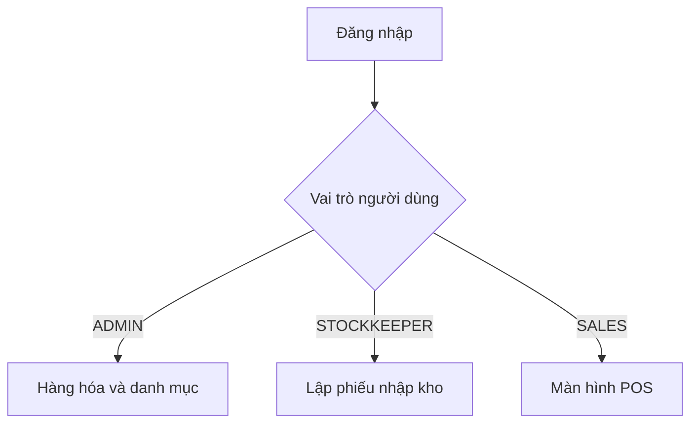

# Tổng quan hệ thống SIMS

**Mục đích tài liệu**: Giới thiệu vai trò, công nghệ và cấu trúc thư mục của hệ thống.

**Ai nên đọc**: Thành viên mới, người triển khai và người bảo trì.

**Cập nhật lần cuối**: 25/11/2026.

**File liên quan**: `routes/web.php`, `app/Http/Controllers/`, `app/Services/`, `app/Models/`, `database/seeders/DatabaseSeeder.php`.

## Công nghệ thực tế

- Laravel: 13.39.0.
- PHP: 8.5.11.
- Cơ sở dữ liệu đang dùng trong môi trường: SQLite. Database được cấu hình bởi `.env`.
- Giao diện: Blade và JavaScript thuần cho POS.

## Ba vai trò

| Vai trò | Hằng được dùng trong code | Chức năng chính |
|---|---|---|
| ADMIN | `ADMIN` | Quản lý danh mục, hàng hóa, nhân sự, phân quyền và báo cáo |
| Thủ kho | `STOCKKEEPER` | Lập phiếu nhập, xem lịch sử nhập và cảnh báo tồn kho |
| Nhân viên bán hàng | `SALES` | Bán hàng POS và xem lịch sử hóa đơn của chính mình |

Phân quyền được áp dụng bằng middleware `role` trong `routes/web.php` và middleware `CheckRole` trong `app/Http/Middleware/CheckRole.php`.

## Điều hướng sau đăng nhập

Luồng chuyển hướng nằm trong closure `dashboard` của `routes/web.php`.

## Cấu trúc thư mục quan trọng

| Thư mục hoặc file | Vai trò |
|---|---|
| `app/Http/Controllers/` | Nhận request, validate dữ liệu và trả view hoặc JSON |
| `app/Services/` | Thực hiện nghiệp vụ có nhiều bước, transaction và khóa dữ liệu |
| `app/Models/` | Ánh xạ bảng dữ liệu và quan hệ Eloquent |
| `app/Exceptions/LoiBanHangException.php` | Ngoại lệ cho lỗi POS mà thu ngân được phép đọc |
| `public/js/pos.js` | Giỏ hàng và tương tác màn hình POS trên trình duyệt |
| `resources/views/pos/` | Giao diện POS và lịch sử hóa đơn |
| `database/migrations/` | Cấu trúc bảng dữ liệu |
| `tests/Feature/ThanhToanPosTest.php` | Kiểm thử luồng thanh toán POS |

## Tài khoản mẫu

Danh sách tài khoản và vai trò được tạo trong `DatabaseSeeder::run()`:

- `admin` - vai trò `ADMIN`.
- `thukho` - vai trò `STOCKKEEPER`.
- `banhang` - vai trò `SALES`.

Mật khẩu mẫu được ghi trong `DatabaseSeeder.php`. Tài liệu này không sao chép mật khẩu để tránh lộ thông tin nhạy cảm.

## Thuật ngữ nhanh

- **SKU**: mã định danh duy nhất của từng mặt hàng.
- **Transaction**: một nhóm thao tác dữ liệu chỉ hoàn tất cùng nhau. Nếu một thao tác lỗi, toàn bộ được hoàn tác.
- **Rollback**: hoàn tác các thay đổi chưa commit trong transaction.
- **lockForUpdate**: khóa dòng dữ liệu khi đang cập nhật để hai giao dịch không ghi đè tồn kho.
- **CSRF**: mã chống giả mạo request POST từ trang khác.
- **Throttle**: giới hạn số request trong một khoảng thời gian.
