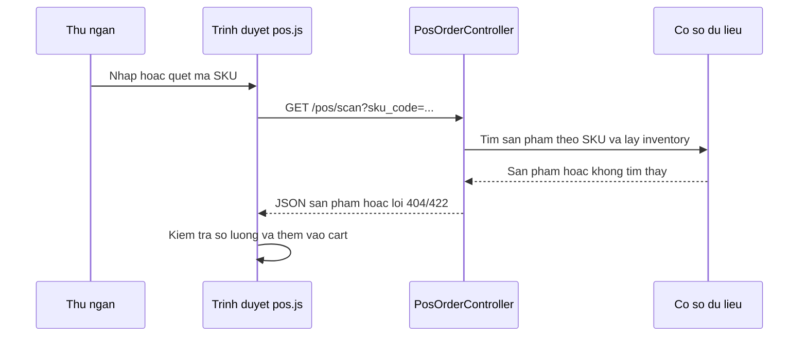
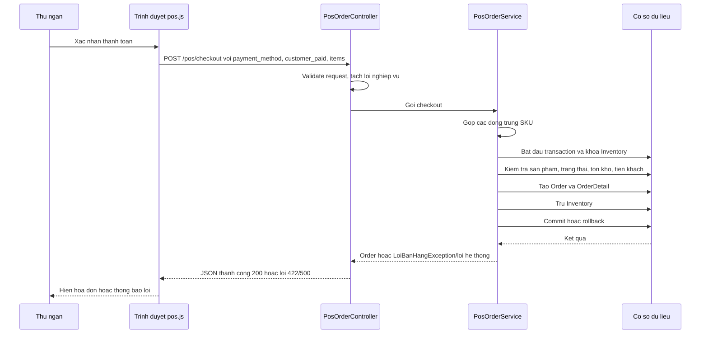
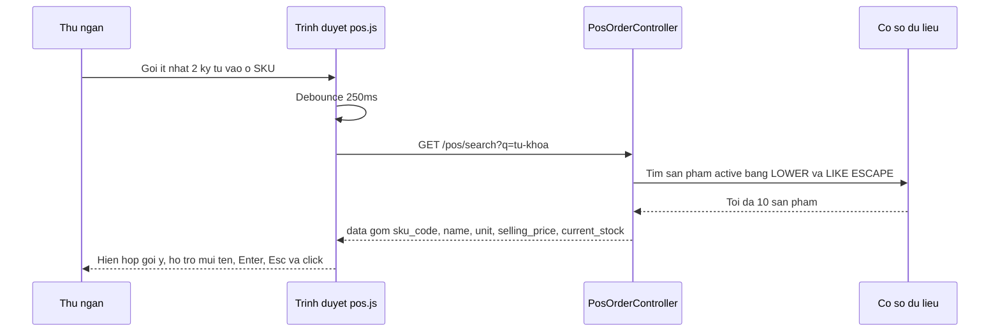

# Luồng bán hàng POS

**Mục đích tài liệu**: Mô tả đầy đủ luồng thu ngân từ mở POS đến thanh toán và xem lịch sử.

**Ai nên đọc**: Người phát triển POS, người kiểm thử và người vận hành thu ngân.

**Cập nhật lần cuối**: 25/11/2026.

**File liên quan**: `routes/web.php`, `PosOrderController.php`, `PosOrderService.php`, `public/js/pos.js`, `resources/views/pos/index.blade.php`, `resources/views/pos/history.blade.php`, `Inventory.php`, `Order.php`, `OrderDetail.php`.

## Tổng quan

Thu ngân mở màn hình `/pos`, quét mã SKU hoặc nhập mã thủ công. Trình duyệt gọi API quét để lấy tên, đơn giá, tồn kho rồi thêm sản phẩm vào giỏ. Giỏ chỉ nằm trong biến `cart` của `public/js/pos.js`, không lưu trong cơ sở dữ liệu. Tải lại trang sẽ làm giỏ mất.

Khi xác nhận thanh toán, trình duyệt gửi SKU và số lượng. Máy chủ không tin đơn giá gửi lên. `PosOrderService::checkout` lấy giá bán từ database, khóa tồn kho, kiểm tra tiền, tạo hóa đơn và dòng chi tiết, trừ tồn rồi commit. Nếu một bước lỗi, transaction gọi rollback để hoàn tác toàn bộ. Sau thành công, giao diện hiện hóa đơn để xem và in.

## Sơ đồ luồng quét mã SKU



## Sơ đồ luồng thanh toán



## Luồng tìm sản phẩm theo tên hoặc SKU một phần

Sơ đồ gợi ý tìm kiếm:



`PosOrderController::timSanPham` bỏ qua từ khóa dưới 2 ký tự hoặc trên 50 ký tự bằng response `{"data":[]}` HTTP 200. API tìm `is_active=true`, so khớp một phần theo `sku_code` hoặc `name`, thoát `%`, `_`, `\` trước khi tạo điều kiện LIKE. Kết quả sắp xếp SKU khớp chính xác trước, SKU bắt đầu bằng từ khóa sau, rồi theo tên và giới hạn 10 dòng. Gợi ý không trả `cost_price`.

Giao diện debounce 250 ms. Chỉ response của lần gọi mới nhất được đổ lên hộp gợi ý. Mũi tên lên/xuống chọn dòng, Enter chọn dòng đang sáng, Esc đóng, bấm chuột chọn và bấm ra ngoài đóng. Khi không có dòng sáng, Enter hoạt động như quét SKU cũ. Tồn kho bằng 0 vẫn hiển thị nhưng disabled và ghi Hết hàng.

## Luồng quét mã SKU

`PosOrderController::scanBarcode` nhận `sku_code` bằng GET.

1. Thu ngân nhập hoặc quét mã vào ô SKU.
2. `pos.js` gửi `GET /pos/scan?sku_code=<mã>`, dùng `encodeURIComponent` để mã hóa ký tự URL.
3. Controller bỏ khoảng trắng đầu/cuối bằng `trim`.
4. Nếu SKU rỗng, trả HTTP 422 và thông báo `Vui lòng nhập mã SKU.`
5. `Product::findBySku` tìm khớp chính xác theo cột `sku_code`.
6. Nếu không tìm thấy hoặc sản phẩm ngừng bán, scan trả HTTP 404 với thông báo `Không tìm thấy sản phẩm có mã <sku>.`
7. Nếu tìm thấy, trả SKU, tên, đơn vị, giá bán và tồn kho hiện tại.
8. `pos.js` nếu đã có SKU trong giỏ thì cộng thêm 1. Nếu thêm vượt tồn, không đổi giỏ và hiện cảnh báo.

## Luồng thanh toán

`PosOrderController::checkout` validate request rồi gọi `PosOrderService::checkout`.

### Bước gộp SKU

`PosOrderService::checkout` gộp các dòng trùng bằng tiền tố khóa `sku:` để SKU toàn chữ số không bị PHP hiểu thành số nguyên trong mảng. Sau đó tách chuỗi SKU bằng `substr`.

### Bước kiểm tra và khóa tồn kho

Trong transaction:

1. Tìm sản phẩm theo SKU.
2. Nếu không tồn tại: `LoiBanHangException` 422.
3. Nếu `is_active=false`: `LoiBanHangException` thông báo sản phẩm đã ngừng bán.
4. Khóa dòng inventory bằng `lockForUpdate`.
5. Nếu không đủ tồn, ném lỗi và rollback.

### Bước tính tiền

Giá bán lấy từ `Product::selling_price`, không lấy trường `unit_price` do trình duyệt gửi. Tiền mặt bắt buộc `customer_paid >= total_amount`. VIETQR được coi như khách đã trả đúng tổng tiền vì ứng dụng chưa tích hợp xác minh chuyển khoản thật.

### Bước lưu dữ liệu

1. Tạo `Order` với mã không trùng và trạng thái `COMPLETED`.
2. Tạo `OrderDetail` lưu `unit_price`, `unit_cost`, `quantity` và `subtotal`.
3. Gọi `Inventory::deductStock` để trừ tồn.
4. Nếu mọi bước thành công, commit; nếu có lỗi bất kỳ, rollback.

Lỗi nghiệp vụ được bắt bởi `LoiBanHangException` và trả 422. Throwable khác được ghi bằng `report($e)` và trả 500 với thông báo chung, không lộ exception kỹ thuật.

## API POS

### GET quét SKU

- URL: `/pos/scan`.
- Middleware: `auth`, `role:SALES`, `throttle:120,1`.
- Query: `sku_code`.

Ví dụ:

```text
GET /pos/scan?sku_code=SP001
```

Response thành công:

```json
{
  "sku_code": "SP001",
  "name": "Áo Polo Nam Basic",
  "unit": "Cái",
  "selling_price": 199000,
  "current_stock": 50
}
```

### GET tìm gợi ý sản phẩm

- URL: `/pos/search?q=<từ khóa>`.
- Middleware: `auth`, `role:SALES`, `throttle:120,1`.
- q dưới 2 ký tự hoặc trên 50 ký tự: HTTP 200 với `{"data":[]}`.
- Chỉ trả tối đa 10 sản phẩm đang bán.

Ví dụ response:

```json
{
  "data": [
    {
      "sku_code": "SP001",
      "name": "Áo Polo Nam Basic",
      "unit": "Cái",
      "selling_price": 199000,
      "current_stock": 50
    }
  ]
}
```

### POST thanh toán

- URL: `/pos/checkout`.
- Middleware: `auth`, `role:SALES`, `throttle:60,1`.
- Request tối đa 100 dòng; mỗi quantity tối đa 9999; customer_paid tối đa 1000000000.

Request mẫu:

```json
{
  "payment_method": "CASH",
  "customer_paid": 500000,
  "items": [
    {"sku_code": "SP001", "quantity": 2},
    {"sku_code": "SP002", "quantity": 1}
  ]
}
```

Response thành công giữ cấu trúc:

```json
{
  "message": "Thanh toán thành công.",
  "order": {
    "order_code": "ORD-YYYYMMDDHHMMSS-XXXX",
    "total_amount": 100000,
    "customer_paid": 150000,
    "change_amount": 50000,
    "payment_method": "CASH",
    "created_at": "25/11/2026 12:00",
    "cashier": "Tên thu ngân"
  }
}
```

| Mã HTTP | Khi nào |
|---|---|
| 200 | Thanh toán thành công |
| 403 | Tài khoản không phải SALES |
| 404 | Không tìm thấy SKU khi quét |
| 422 | SKU trống, validation sai, thiếu tiền, hết hàng, ngừng bán hoặc lỗi nghiệp vụ khác |
| 500 | Lỗi hệ thống bất ngờ; không lộ chi tiết lỗi kỹ thuật |

## Hành vi giao diện

`public/js/pos.js` có:

- Giỏ hàng lưu trong biến `cart`, mất khi tải lại trang.
- Cờ `submitting` khóa gửi thanh toán khi request đang chạy.
- Nút thanh toán bị disable trong lúc gửi.
- F9 chạy checkout trừ khi phím đang giữ (`event.repeat=true`) hoặc đang focus ô số lượng.
- Ô SKU và ô tiền khách vẫn cho F9 hoạt động.
- Ô số lượng chỉ nhận số nguyên từ 1 trở lên. Giá trị rỗng, âm, chuỗi hoặc số thập phân không đổi số lượng cũ.
- Nếu vượt tồn, số lượng được đưa về tồn hiện tại.
- Các nút tiền mặt nhanh chọn đúng tổng, làm tròn tiền hoặc mệnh giá lớn.

## Hai phương thức thanh toán

| Phương thức | Cách xử lý server |
|---|---|
| `CASH` | Bắt buộc customer_paid không nhỏ hơn tổng; change_amount = customer_paid - total_amount |
| `VIETQR` | Server đặt customer_paid bằng total_amount; không có tiền thừa và không xác minh ứng dụng ngân hàng |

VIETQR trong dự án chỉ là minh họa giao diện. Đây không phải giao dịch ngân hàng thật.

## Hóa đơn

Sau thanh toán thành công, giao diện hiện:

- Mã hóa đơn.
- Thu ngân.
- Giờ tạo.
- Phương thức thanh toán.
- Từng SKU, tên, số lượng, đơn giá và thành tiền.
- Tổng tiền, tiền khách đưa và tiền thừa.

Nút in gọi `window.print`. CSS `@media print` trong `public/css/sims.css` ẩn thanh điều hướng và phần không cần in.

## Lịch sử giao dịch

`PosOrderController::myHistory` lọc `cashier_id = Auth::id()` và eager load `details.product`. Mặc định không lọc ngày và hiển thị tất cả hóa đơn của thu ngân bằng `simplePaginate(20)`. Có thể gửi `start_date` và `end_date` theo định dạng YYYY-MM-DD, khoảng tối đa 366 ngày. Tổng số hóa đơn và tổng tiền chỉ tính hóa đơn COMPLETED bằng truy vấn tổng hợp, không cộng trên trang hiện tại.

API lịch sử:

- `GET /pos/history`: danh sách phân trang.
- `GET /pos/history/{order}`: xem chi tiết hóa đơn; route chỉ nhận số và middleware role SALES.
- Hóa đơn của thu ngân khác hoặc không tồn tại trả HTTP 404.

Giao diện chi tiết dùng `pos/chi-tiet-hoa-don.blade.php`, hiển thị nhãn BẢN IN LẠI, nút In và nút Quay lại. View không hiển thị `unit_cost` hoặc giá vốn.
